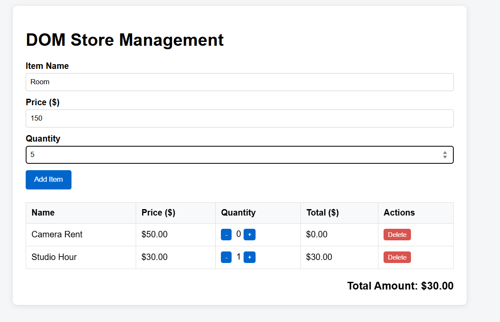
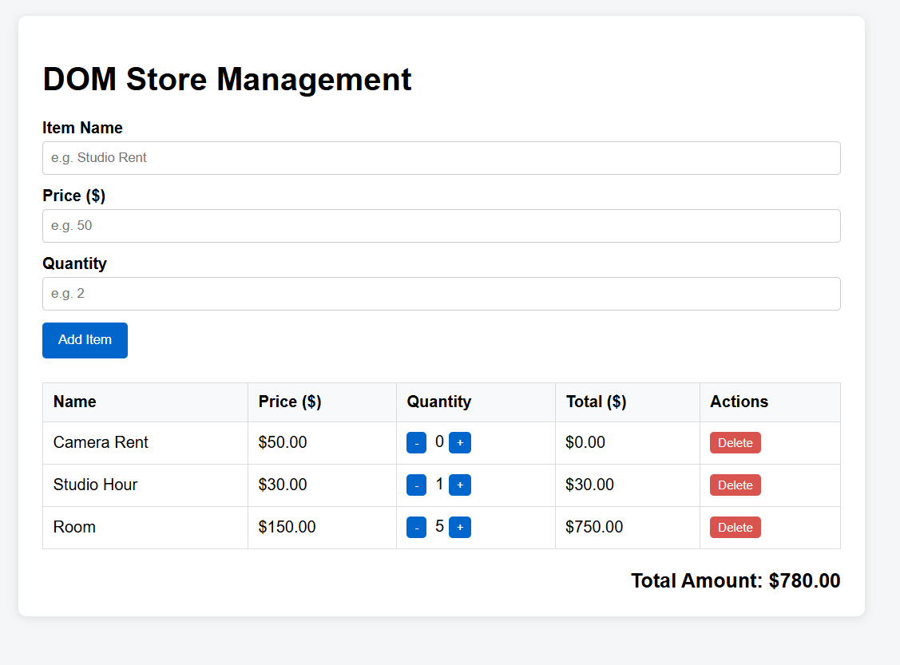
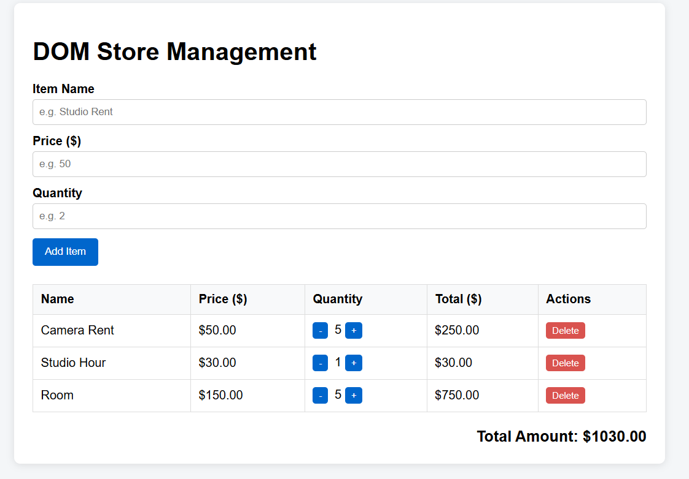

# DOM Store - Lab 5

**Repository:** `dom-store-zhuman`  
**Author:** Zhuman Ayan  

---

## How to Open

Open the `index.html` file directly in any modern browser or run it using Live Server extension in VS Code.

---

## Events Processed in Code

1. **`submit` event on `<form>`:** Handled to process new item creation. `e.preventDefault()` is used to prevent default page reloads, allowing custom DOM validation and state updates without refreshing.
2. **`click` event with Event Delegation on `<tbody>`:** Attached a single click listener to the container list element to handle `delete`, `increment`, and `decrement` operations dynamically using `data-action` attributes. This eliminates the need to bind individual event listeners to every row.
3. **`click` on action buttons:** Dynamically updates quantities and recalculates the live total amount across the Store instance in real-time.

---

## Screenshots

| 1. Initial State | 2. Form Validation |
| :---: | :---: |
|  |  |

| 3. Dynamic Total & Actions |
| :---: |
|  |

## AI Tools Used

- **Gemini AI / ChatGPT:** Used for structuring DOM event delegation logic, clean HTML form validation errors layout, and generating project README.